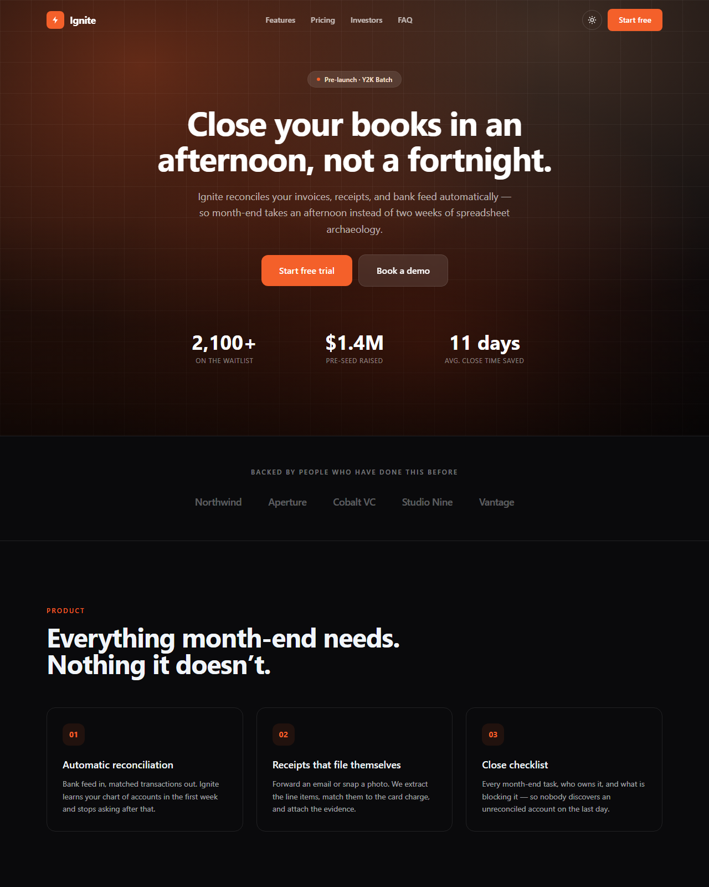

# ⚡ Ignite — Free Startup Landing Page Template

**A production-ready startup landing page built with Next.js 15, TypeScript, and Tailwind CSS v4.** Waitlist mode, an investor section, and analytics already wired to every button. Clone it, edit one config file, deploy for free.

**[Live demo →](https://pixelandoak-ignite.pages.dev)**



## The one feature other templates don't have

Startups need two completely different landing pages, three months apart:

1. **Before launch** — a focused page whose only job is capturing emails.
2. **After launch** — features, pricing, and a real signup flow.

Most founders build the first, throw it away, then rebuild the second. Ignite is both, behind one flag:

```ts
// config/site.ts
waitlistMode: true,   // → hero + email capture + proof + FAQ
waitlistMode: false,  // → the full landing page with features, pricing, investors
```

Flip it on launch day, `npm run build`, redeploy. Nothing is thrown away, and you never maintain two sites.

## Analytics you don't have to wire up

Every meaningful interaction already calls `track()`. You do not go and add event code — you point `lib/analytics.ts` at your provider and the funnel starts reporting.

| Event | Fires when |
| --- | --- |
| `waitlist_submitted` | Someone joins the waitlist |
| `cta_clicked` | Any CTA, with `location` and `plan` props |
| `pricing_viewed` | Pricing scrolls into view — your best drop-off signal |
| `faq_opened` | An FAQ is expanded, with the question |
| `demo_requested` | A demo CTA is used |

Plausible, Fathom, PostHog, and GA4 are all auto-detected — just add your snippet to `app/layout.tsx`. With no provider installed, events log to the console so you can watch the funnel work in development.

## Everything else

- 🎯 **Waitlist + launch modes** from one config flag
- 💼 **Investor section** — market, wedge, traction, team. The section founders always end up building by hand during the worst week to be building anything
- 💳 **Pricing** — three tiers, featured card, per-plan analytics
- ❓ **FAQ accordion** — native `<details>`, works with zero JavaScript, emits `FAQPage` structured data for rich results
- 🌙 **Real dark mode** — class strategy, localStorage, OS detection, no flash
- 🖼️ **Zero image files** — the aurora hero and grid are pure CSS. Nothing to license, nothing slow
- 📦 **Static export** — `/out` deploys free to any static host
- 📱 **Responsive** — verified with no horizontal scroll at 375px and 1280px

## Quick start

```bash
git clone https://github.com/haider484991/ignite-nextjs-startup-template.git my-startup
```

```bash
cd my-startup && npm install && npm run dev
```

Open [http://localhost:3000](http://localhost:3000).

## Make it yours

Everything lives in **`config/site.ts`**:

```ts
export const siteConfig = {
  name: "Ignite",
  waitlistMode: false,

  hero: {
    badge: "Pre-launch · Y2K Batch",
    headline: "Close your books in an afternoon, not a fortnight.",
    sub: "…",
  },

  proof: {
    metrics: [{ value: "2,100+", label: "On the waitlist" }],
  },

  pricing: [
    { name: "Growth", price: "$149", period: "/month", featured: true,
      features: ["3 entities", /* … */], cta: "Start free trial" },
  ],

  investors: { enabled: true, points: [["Market", "…"], ["Wedge", "…"]] },
};
```

**Collecting real signups:** set `waitlistAction` to your form endpoint (Formspree, ConvertKit, Mailchimp, Loops, Resend, or your own API route). While it is empty, the form shows a built-in demo confirmation.

**A word on the numbers:** the sample traction figures are placeholders. Replace them with real ones. Inflated metrics are the fastest way for a founder to lose credibility with both users and investors, and they are trivially checkable.

## Deploy

```bash
npm run build
```

Emits `/out`:

```bash
npx wrangler pages deploy out
```

Netlify, Vercel, GitHub Pages, and any static host work identically.

## Tech

Next.js 15 (App Router, static export) · React 19 · TypeScript · Tailwind CSS v4 · zero runtime dependencies beyond React.

## License

MIT — free for personal and commercial use. Attribution appreciated but not required.

---

Built by [Pixel & Oak](https://pixelandoak.com) — web design and AI development studio.
More free templates: [Nova (blog)](https://github.com/haider484991/nova-nextjs-blog-template) · [LaunchPad (SaaS)](https://github.com/haider484991/launchpad-nextjs-saas-template) · [Table & Fork (restaurant)](https://github.com/haider484991/tablefork-nextjs-restaurant-template) · [Lumen (photography)](https://github.com/haider484991/lumen-nextjs-photography-template)
